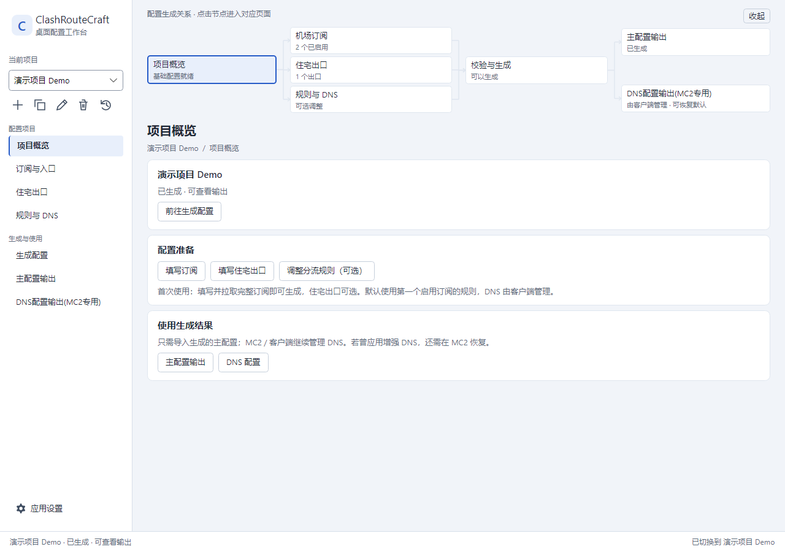
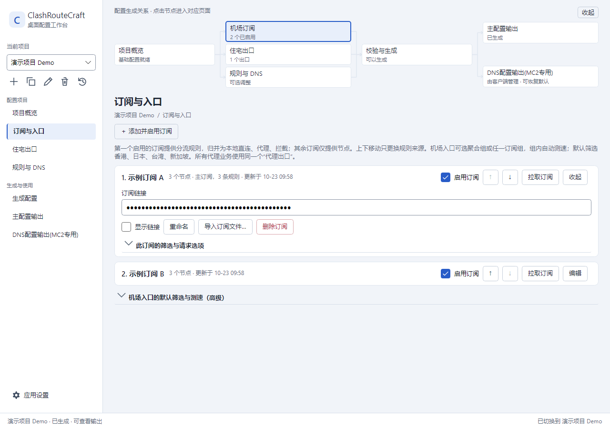
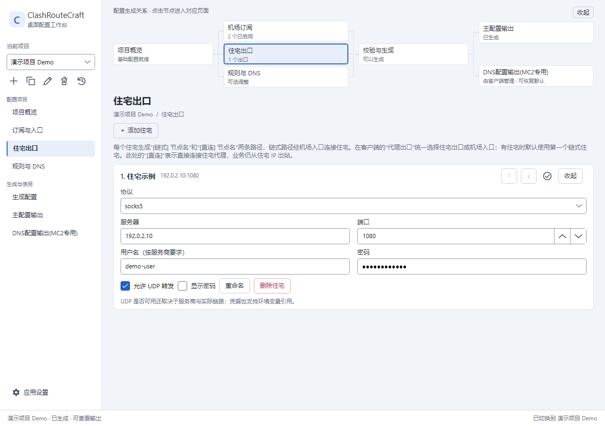
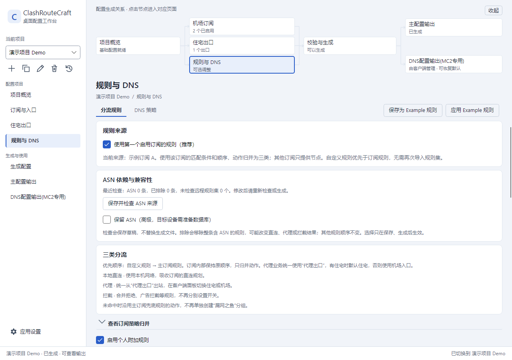
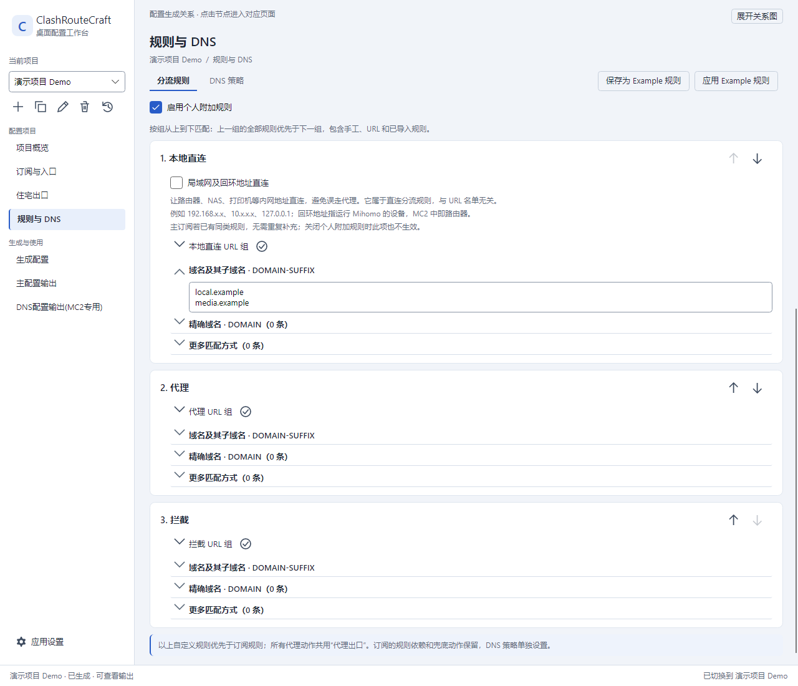
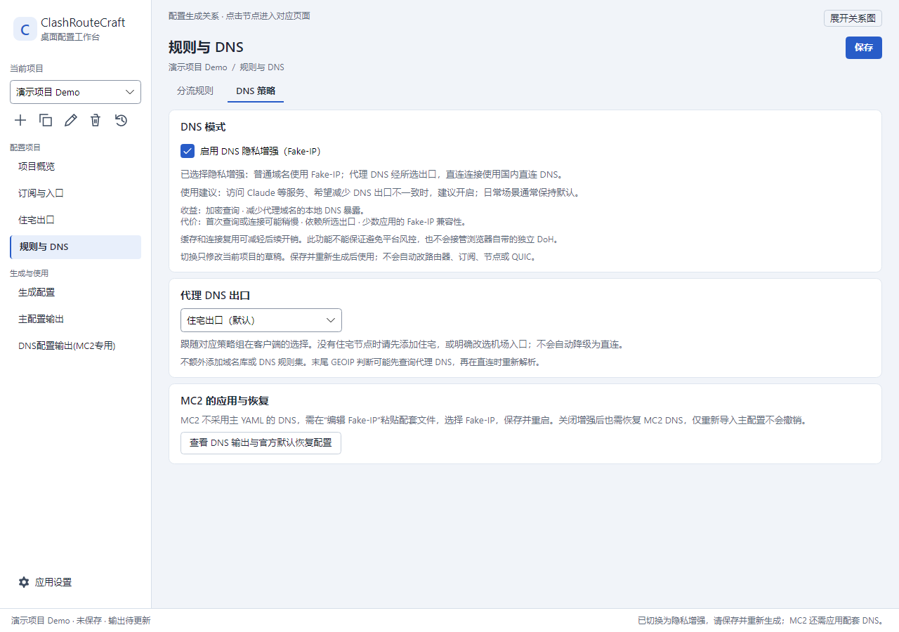
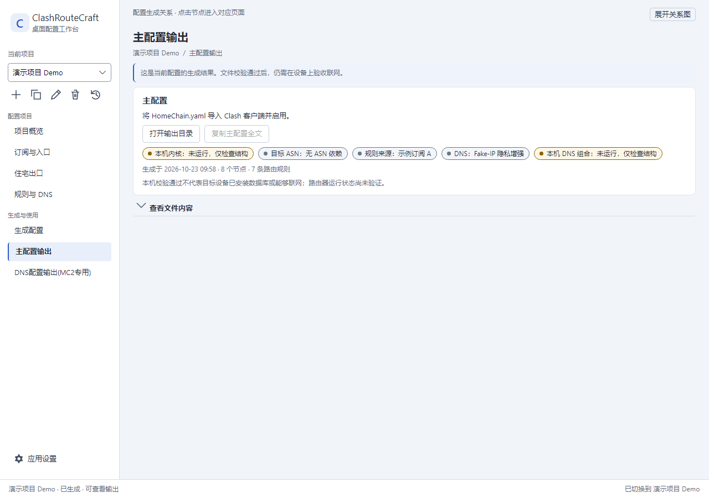

# ClashRouteCraft

**中文** · [English](README.en.md)

把订阅节点、静态住宅出口和自己的分流规则，组合成可检查、可导出的 Clash / Mihomo 配置。

**[下载最新 Windows x64 AOT 版](https://github.com/QingC2206/app-clash-route-craft/releases/latest/download/ClashRouteCraft-win-x64.zip)** · [Release 与更新说明](https://github.com/QingC2206/app-clash-route-craft/releases/latest) · [SHA-256 校验文件](https://github.com/QingC2206/app-clash-route-craft/releases/latest/download/SHA256SUMS.txt)

当前发布：**[v1.16.5](https://github.com/QingC2206/app-clash-route-craft/releases/tag/v1.16.5)**。Windows x64 便携版，无需安装 .NET。程序负责生成配置，实际流量由你的 Clash / Mihomo 客户端或 MC2 路由器处理。



> 本页截图由真实界面在独立临时工作区中渲染，全部使用虚构项目、示例订阅和保留测试地址，不含个人项目数据。界面当前为中文；英文使用说明见 [English README](README.en.md)。

## 安装与第一次使用

1. 下载 ZIP，**完整解压**到可写目录，运行 `ClashRouteCraft.exe`。不要在 ZIP 内直接运行，也不要只复制 EXE：同目录的 DLL 也需要保留。
2. 首次启动会创建通用只读 `Example` 和默认模板。新建自己的项目，在“订阅与入口”填写并拉取订阅，或导入完整 Clash / Mihomo 配置。
3. 默认采用**第一个启用订阅的规则**，其他订阅只提供节点。住宅出口可选，不配置住宅时可直接使用机场入口。
4. 按需补充直连、代理、拦截规则。DNS 默认由客户端管理，首次使用可保持默认。
5. 在“生成配置”选择目标、检查并生成，到“主配置输出”打开结果，将 `HomeChain.yaml` 导入对应客户端。生成文件不会自动应用到路由器。

Mihomo 校验内核和 GeoData 不随 ZIP 分发，需要时通过应用的资源下载入口获取；MC2 安装包不在下载范围内。**只有节点、没有规则的缓存不能作为主规则来源**，需重新拉取或导入完整配置。

## 核心功能

### 多订阅，一个规则基线



第一个启用的完整订阅提供规则，保留它的匹配条件和顺序；其余订阅只补充节点，不混合多套订阅规则。上下移动订阅即可改变规则来源。

“机场入口”可选择全部订阅的**聚合组**，也可选择某一个订阅组。默认筛选香港、日本、台湾和新加坡，支持自定义筛选与测速。节点解析所需的 `hosts` 随缓存和生成传递，映射冲突或别名循环会提示处理，不会静默覆盖。

### 住宅出口可选，代理统一出站



代理业务统一指向“代理出口”，在客户端面板选择“住宅出口”或“机场入口”。配置了住宅时默认住宅，否则使用机场。

| 路径 | 连接方式 |
| --- | --- |
| `[链式] 住宅节点名` | 先经过机场节点，再连接住宅代理，从住宅 IP 出站 |
| `[直连] 住宅节点名` | 直接连接住宅代理，仍从住宅 IP 出站 |
| 规则中的本地直连 `DIRECT` | 使用本地网络，不经过住宅或机场代理 |

住宅“直连”描述的是**连接住宅代理的方式**，与业务规则中的 `DIRECT` 不同。住宅的 UDP 和 TLS 选项不会被统一覆盖，实际可用性仍取决于服务商和链路。

### 三类分流，自定义规则优先



订阅中的动作归并为**本地直连、代理、拦截**。广告拦截等拒绝规则归入拦截；代理业务统一出口；未命中时沿用主订阅的兜底动作，不额外创建“漏网之鱼”分组。



匹配原则：**全部用户自定义规则 → 主订阅规则**。自定义三组按界面从上到下匹配，上一组的手工名单、URL 名单及已有导入规则都优先于下一组。通过箭头调整顺序，不会因去重删除同条件的备用动作；`PASS` 等继续匹配语义仍保留。

例如需要放行被拦截规则覆盖的域名，可把对应直连或代理组放在拦截组上方。也可整体停用个人附加规则，保留内容供后续恢复。

“保存为 Example 规则”和“应用 Example 规则”可复用规则模板，应用时保留当前订阅、节点和 DNS。高级自定义模式还支持从文件、URL、粘贴内容或已拉取订阅导入规则集并映射策略；订阅基线无需重复导入同一套规则。

### DNS 默认不干预，隐私增强按需开启



默认由客户端 / MC2 管理 DNS。可选的 **Fake-IP DNS 隐私增强**使用加密查询，代理 DNS 默认经住宅出口，也可改选机场入口；不额外引入域名库，不修改 QUIC。截图展示手动启用后的状态，**出厂默认关闭**。

增强模式可减少代理域名在本地 DNS 上的暴露，但首次查询或建连可能更慢，依赖所选出口，也有部分应用的 Fake-IP 兼容性限制。它不保证绕过平台风控，也不接管浏览器独立的 DoH。

**MC2 需要单独应用配套 DNS。** 开启后按说明应用 `HomeChain.MC2DNS.yaml`；关闭增强后，也要在 MC2 恢复默认或先前保存的 DNS，仅导入主 YAML 不会撤销 DNS 设置。程序同时输出基于 MC2 1.2.2 ARM64 的原装 Fake-IP 恢复模板及说明。步骤见 [使用与恢复指南](docs/usage.md)。

### 检查依赖，明确生成结果



报告列出规则来源、DNS 模式、本机校验状态及目标数据库依赖。截图示例未配置校验内核，因此如实显示“未运行，仅检查结构”；**本机校验通过也不等于路由器已完成联网验证**。

MC2 的 ASN 检查支持按来源排除 ASN 规则，或在目标设备准备好数据库后选择“保留 ASN”。主要输出如下：

| 文件 / 目录 | 用途 |
| --- | --- |
| `HomeChain.yaml` | Clash / Mihomo / MC2 主配置 |
| `HomeChain.report.json` | 生成与校验报告 |
| `HomeChain.MC2DNS.yaml` | 启用相应 DNS 配置时生成的 MC2 配套文件 |
| `HomeChain.MC2DNS.Default.yaml` | MC2 目标的指定版本原装 DNS 恢复模板 |
| `HomeChain.DNS-README.txt` | MC2 DNS 应用与恢复说明 |
| `router-asn/` | 独立 ASN 安装工具及说明 |

ASN 工具支持 PowerShell、Linux / macOS 终端，要求电脑具备 Python 3.10+。工具先鉴权再下载，经 SSH 上传并核对 SHA-256、调用路由器内核验证，支持备份和失败回滚，不自动重启 MC2。SSH 主机记录按项目隔离，同地址的不同路由器互不干扰，同一项目指纹变化仍会拒绝连接。详见 [ASN 安装指南](docs/router-asn.md)。

## 升级与数据保留

1. 关闭正在使用的 ClashRouteCraft，备份自己的工作区。
2. 将新版 ZIP 解压到临时目录，把程序文件、DLL 和随附文档复制到原安装目录，替换同名文件。
3. **保留**原来的 `config/`、`settings/`、`output/`、`resources/`、`.cache/`、`.project-trash/` 等数据目录，不要删除整个安装目录后重装。
4. 重新打开程序。要更新已有项目的输出工具时，重新生成该项目；账户文件 `router-login.json` 和项目 SSH 记录 `router-known_hosts` 会保留。配置需另行导入客户端才生效。

默认工作区位于程序自身目录。换到新的安装目录会建立独立工作区；如需迁入旧数据，先备份，再使用应用的工作区迁入功能。便携版会将数据迁入新 EXE 目录，不是仅打开原路径；不会自动搜索或迁移其他目录。旧版只保存节点的缓存无法恢复丢失的规则或 `hosts`，需重新拉取完整订阅。

## 隐私与边界

- 内置模板仅含通用占位配置；分发包不含真实项目、订阅、节点凭据、生成结果、SSH 登录文件或下载资源。
- `.gitignore` 排除运行数据、账户文件、SSH 主机记录和 macOS 缓存。忽略规则不能清除已提交的秘密，提交前仍需检查内容。
- `router-login.json` 是可选的本地明文登录文件，请妥善保管，不要分享。
- 桌面程序当前发布 Windows x64 版；Linux / macOS 支持指独立 ASN 脚本，不代表已有相应桌面发行包。
- 生成配置、编译或升级程序不会自动修改路由器。使用结果前请在目标设备核对依赖和联网状态。

## 开发与验证

使用 .NET 10 和 Avalonia；开发运行需 .NET 10 SDK，Windows Native AOT 发布还需要 Visual Studio C++ 构建工具与 Windows SDK。

```powershell
dotnet build ClashRouteCraft.slnx -c Release
dotnet run --project src/ClashRouteCraft.Desktop -c Release
dotnet publish src/ClashRouteCraft.Desktop -c Release -r win-x64 --self-contained true -p:PublishAot=true -o artifacts/publish/win-x64-aot
```

```text
src/                       核心库与桌面应用
tests/                     回归测试与虚构夹具
scripts/                   构建、打包与独立工具
tools/python-reference/    历史 Python 参考实现
docs/                      使用指南、验证说明与界面截图
```

测试命令、真实内核检查和历史 Python 对照的已知差异见 [验证说明](docs/validation.md)。截图来源和复现命令见 [截图说明](docs/screenshots/README.md)。

仅在需要分发包时执行以下命令；日常 AOT 编译不打包 ZIP。打包只产生一个 Windows x64 版本，并排除工作区数据。

```powershell
pwsh -File scripts/Prepare-Notices.ps1
pwsh -File scripts/Package.ps1
python scripts/check-release.py
```

## 文档与许可证

[使用指南](docs/usage.md) · [ASN 安装指南](docs/router-asn.md) · [验证说明](docs/validation.md) · [反馈问题](https://github.com/QingC2206/app-clash-route-craft/issues)

源码采用 [MIT License](LICENSE)。第三方组件遵循各自许可证，见 [第三方说明](THIRD-PARTY-NOTICES.md)。
